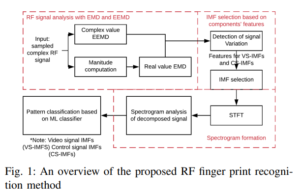
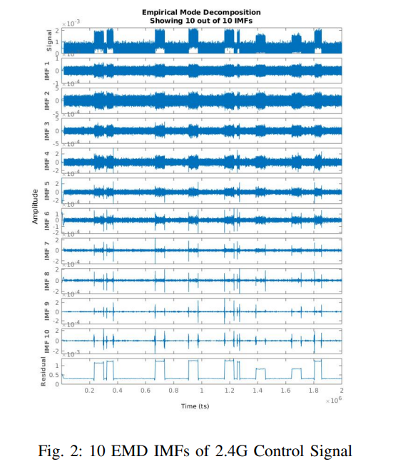
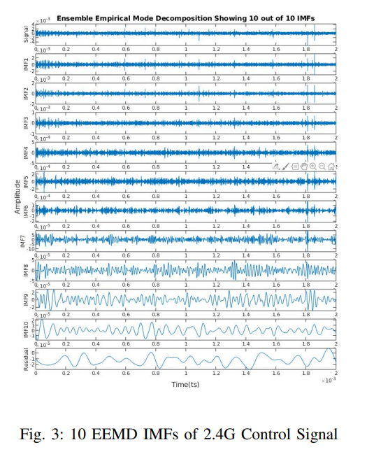
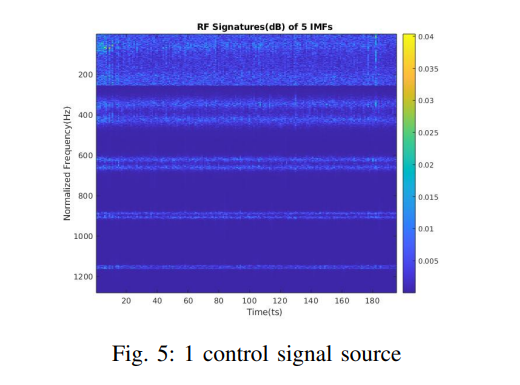
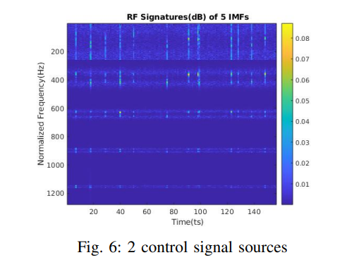
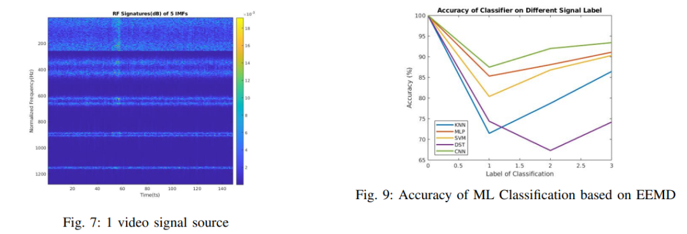

# Drone Technology Breakthrough: A New Solution for Radio Frequency Fingerprint Decomposition Based on EMD/EEMD and Machine Learning [with MATLAB+Python Code]

Personal Blog: https://www.cnblogs.com/EWFrontier  
✿Breaking through the bottleneck of drone detection! A new scheme for radio frequency fingerprint decomposition based on EMD/EEMD and machine learning ✿1. Title: Adaptive Radio Frequency Fingerprint Decomposition in Micro UAV Detection Based on Machine Learning
2. Abstract: Radio frequency (RF) signal classification has been widely applied in the feature detection and recognition of unmanned aerial vehicles (UAVs). This paper proposes an approach based on empirical mode decomposition (EMD) and ensemble empirical mode decomposition (EEMD) to extract communication channel features of intruding UAVs. The intrinsic mode functions (IMFs) after decomposition, which remove noise components, are combined with machine learning (ML) for radio frequency signal pattern recognition. Classification results show that the denoising effect brought by EMD and EEMD can both improve the detection accuracy under different RF communication channel features, especially in recognizing time-varying RF signal sources.
Doppler radar has been used for years in micro UAV detection research [5]-[7], where micro Doppler characteristics generated by rotating propellers have been effectively applied in the detection of unknown UAVs [8]-[10]. In related studies [11]-[12], researchers have shown that short-time Fourier transform (STFT) and fast Fourier transform (FFT) can estimate the rotating characteristic, rotational speed, and blade physical parameters of micro UAVs through long-term signal sampling. However, the limited surveillance area of active radars leads to low spectral resolution, making it difficult to achieve long-distance detection.
Radio frequency fingerprints have also been used as the main basis for micro UAV detection. Some studies [13]-[15], [20] use traditional STFT and machine learning algorithms to obtain time-frequency energy spectrum patterns when a UAV is present; study [16] explores static RF source detection methods through indoor experiments, aimed at identifying the number of intruding UAVs. Since RF communication has scattering transmission and reception characteristics, short-time signal sampling does not affect the effectiveness of long-distance detection based on RF, but low SNR and increasingly complex wireless signal environments remain major challenges.
Compared to traditional Fourier transform, Empirical Mode Decomposition (EMD) has shown superiority in suppressing vibrations of drone bodies and noise generated by environmental interference [11]. The study [9] extracted six commonly used entropy features from micro-Doppler characteristics (m-DS) through the selection of Intrinsic Mode Functions (IMF), and the results showed that these feature combinations can effectively identify the presence of drones. The study [8] explored the possibility of reconstructing propeller rotation signals using EMD to distinguish the micro-Doppler characteristics of miniature drones.
Inspired by the above two methods for signal denoising, this paper proposes applying EMD and EEMD to extracting radio frequency fingerprint features of intruding drones, achieving remote drone detection. After decomposing the received signals to remove noise components, Intrinsic Mode Functions (IMF) are selected, combined with machine learning for radio frequency signal pattern recognition. Finally, various machine learning classifiers such as Convolutional Neural Network (CNN), Multilayer Perceptron (MLP), Decision Tree, Support Vector Machine (SVM) are trained to compare the denoising performance of EMD and EEMD on received signal data.
The overall framework of the method proposed in this paper for obtaining time-varying radio frequency signal patterns of micro-drones is shown in Figure 1. Firstly, by transforming the received complex signals, two types of Intrinsic Mode Functions (CS-IMFs and VS-IMFs) are obtained; then, non-noise and feature-rich Intrinsic Mode Functions are selected, and a Short Time Fourier Transform (STFT) is used to construct a time-frequency energy spectrum; finally, machine learning classifiers are utilized to recognize intruding drones based on the received radio frequency signal patterns.
(I) EMD and EEMD EMD was first proposed by Huang et al. [17] as a data-driven nonlinear, non-stationary signal analysis method. As an adaptive method, EMD can decompose time series data into a set of Intrinsic Mode Functions (IMF), which form the basis of signal representation and most can physically reflect the underlying processes without harmonic assumptions [18]. Its mathematical expression is as follows:
Among them, the kth Intrinsic Mode Function (IMF) represents the frequency component, which is the residual between the local extremum and the final decomposed IMF signal. In this paper, K takes a value of 10.
The linear combination of intrinsic mode functions and residual functions constitutes the decomposed signal. The acquisition process of intrinsic mode functions can be explained by the following formula:
Among them, the average of upper and lower envelopes is the potential inherent mode function, which needs to meet the following screening criteria:
In the formula, denotes the standard deviation of the sum of difference rates. When it is less than a set threshold, the potential function can be defined as an Intrinsic Mode Function (IMF).
However, due to the uneven distribution of signal extremum points, EMD suffers from modal mixing decomposition deficiencies. Ensemble empirical mode decomposition (EEMD) [19] addresses this issue by defining the true intrinsic mode functions as the mean of multiple trial results. The specific steps are as follows:
1  
Add a finite-amplitude white noise sequence to the target time series data, and decompose it into Intrinsic Mode Functions (IMF);
2  
Repeat steps 1 multiple times, each time adding a different white noise sequence, and perform ensemble averaging on the corresponding intrinsic mode functions obtained from decomposition to obtain the final intrinsic mode function (IMF).
Figure 2 presents the EMD decomposition results of the 2.4G uplink signal for the micro drone, where the tenth IMF still maintains the same triggering edge as the original signal, indicating that EMD fails to fully extract the characteristic signals of packet transmission under a limited number of IMF decompositions, resulting in modal mixing. However, EEMD can already capture the core features of the 2.4G uplink signal between the micro drone and remote controller at the fifth IMF. The sixth to tenth IMFs approach white noise characteristics (when there are no drone communication link packet transmissions, these IMFs are primarily dominated by noise), hence selecting the first to fifth IMFs for subsequent pattern construction through STFT.
(II) Short-Time Fourier Transform (STFT) Based on Intrinsic Mode Functions (IMF)
The STFT of signals is used to obtain the frequency spectrum of the Intrinsic Mode Functions (IMF), which are calculated based on the amplitude of the signal. The mathematical expression is as follows:
where, represents the signal corresponding to each IMF (discrete window function), n is the number of sampling points, N is the length of the analysis window for the Fourier transform analysis, and m is the position of the analysis window (satisfies). k is the index of frequency components (corresponding, and).
To observe the time-frequency characteristics of different Intrinsic Mode Functions, a short-time Fourier Transform (STFT) is applied to each IMF to obtain the time-frequency energy distribution of the signal, highlighting the features of the signal for recognition. Experimental results show that after EMD decomposition, the principal components of the first five IMFs have stable signal strength in the time domain, and can clearly distinguish the packet transmission characteristics of data (as shown in Figure 5-7), even recognizing multiple control signal sources, providing potential for multi-drone detection.
V. Conclusion This paper proposes a new method for micro drone detection by applying EMD and EEMD signal decomposition. The method decomposes the bandwidth-limited drone control signals and video signals into multiple sets of Intrinsic Mode Functions (IMF), each corresponding to different frequency components in the communication link between the drone and remote controller. By classifying patterns constructed from the Intrinsic Mode Functions using different machine learning classifiers, it is shown that both methods have significant advantages in distinguishing different characteristics of the drone radio frequency communication channel, significantly improving detection accuracy.
★

## Images

<!-- PAYMENT_BLOCK -->

## Get this dataset

- Payment link (Stripe): [Buy now](https://buy.stripe.com/3cs8yP7sY87d0vu9AB)
- Payment QR code: 

<!-- /PAYMENT_BLOCK -->
